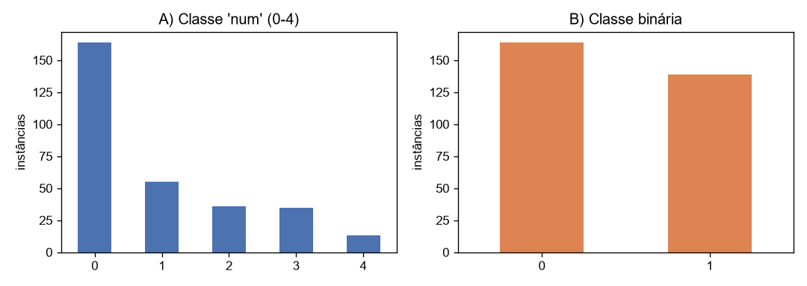
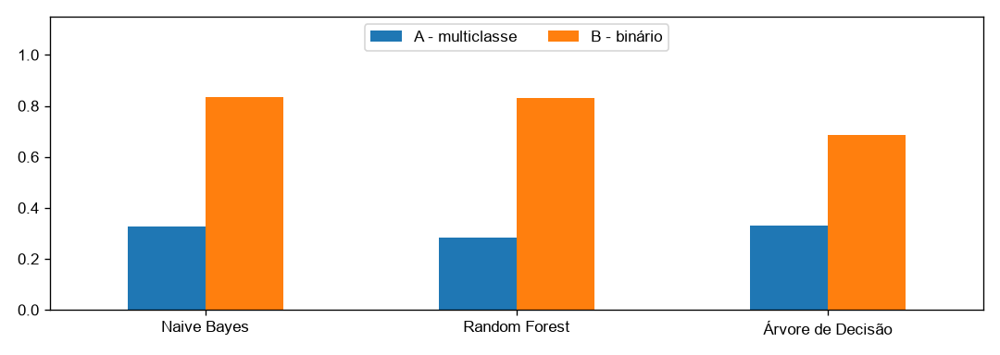

## 1 Apresentação do dataset

O dataset escolhido foi o *Heart Disease* (base Cleveland), do repositório da UCI (JANOSI et al., 1988), disponível em <https://archive.ics.uci.edu/dataset/45/heart+disease>. Ele reúne dados clínicos de 303 pacientes da Cleveland Clinic que fizeram angiografia, como idade, sexo, tipo de dor no peito, pressão, colesterol e resultado do teste de esforço. O propósito é prever o diagnóstico de doença arterial coronariana.

O atributo classe (*target*) é `num`, que indica o grau de estreitamento das artérias: 0 significa ausência de doença, e os valores de 1 a 4 indicam doença presente, em níveis crescentes.

## 2 Caracterização dos dados

O dataset possui 303 instâncias e 14 atributos, sendo 13 preditores e a classe. A Tabela 1 apresenta o tipo, o intervalo ou conjunto de valores e a quantidade de valores faltantes de cada atributo. Destacam-se os seguintes pontos:

1. dois atributos possuem valores faltantes: `ca` (4) e `thal` (2), totalizando 6 valores;
2. o atributo mais desbalanceado é `restecg`, com 151, 148 e apenas 4 instâncias em seus três valores, uma razão de 37,8 vezes entre a maior e a menor classe;
3. entre os atributos binários, o mais desbalanceado é `fbs`, com 258 contra 45 instâncias.

Tabela 1 – Caracterização dos atributos do dataset

| Atributo | Tipo | Valores | Faltantes | Atributo | Tipo | Valores | Faltantes |
|---|---|---|---|---|---|---|---|
| age | numérico | 29 a 77 | 0 | thalach | numérico | 71 a 202 | 0 |
| sex | categórico | {0, 1} | 0 | exang | categórico | {0, 1} | 0 |
| cp | categórico | {1, 2, 3, 4} | 0 | oldpeak | numérico | 0 a 6,2 | 0 |
| trestbps | numérico | 94 a 200 | 0 | slope | categórico | {1, 2, 3} | 0 |
| chol | numérico | 126 a 564 | 0 | ca | categórico | {0, 1, 2, 3} | **4** |
| fbs | categórico | {0, 1} | 0 | thal | categórico | {3, 6, 7} | **2** |
| restecg | categórico | {0, 1, 2} | 0 | **num (classe)** | categórico | {0, 1, 2, 3, 4} | 0 |

Fonte: elaborado pelos autores (2026).

A Figura 1 mostra que a classe original também é desbalanceada: a classe 0 tem 164 instâncias, enquanto a classe 4 tem apenas 13.

Figura 1 – Distribuição do atributo classe nas duas variações de pré-processamento

Fonte: elaborado pelos autores (2026).

## 3 Pré-processamento

Foram realizados os seguintes procedimentos de pré-processamento:

1. comum às duas variações: os 6 valores faltantes (`?`) de `ca` e `thal` foram substituídos pela moda de cada atributo, mantendo todas as 303 instâncias;
2. variação A (multiclasse): a classe `num` foi mantida com 5 valores (0 a 4), tratada como nominal, gerando o arquivo `dados/heart_multiclasse.csv`;
3. variação B (binária): `num` foi convertida em booleano (0 = ausência; 1 a 4 = presença), como fazem os estudos citados no repositório, gerando o arquivo `dados/heart_binario.csv`.

Os experimentos foram executados pelo script `experimento.py`, em Python com a biblioteca scikit-learn (PEDREGOSA et al., 2011), usando validação cruzada estratificada de 10 *folds*. Precisão, *recall* e *F-Measure* são médias macro, em que todas as classes têm o mesmo peso. O tempo é o de treino do modelo com a base completa, em segundos. Os arquivos de entrada (originais e pré-processados), os modelos, o script e os logs estão disponíveis em <https://github.com/renanlapazini/aprendizado-de-maquina>.

## 4 Resultados

As Tabelas 2 e 3 apresentam o desempenho médio dos três algoritmos em cada variação de pré-processamento, e a Figura 2 compara o *F-Measure* obtido.

Tabela 2 – Resultados da variação A (multiclasse, 0 a 4)

| Algoritmo | Acurácia | Precisão | Recall | F-Measure | Tempo (s) |
|---|---|---|---|---|---|
| Árvore de Decisão | 50,8% | 0,343 | 0,328 | **0,329** | 0,002 |
| Naive Bayes | **56,1%** | 0,323 | **0,345** | 0,327 | 0,002 |
| Random Forest | **56,1%** | 0,288 | 0,307 | 0,285 | 0,121 |

Fonte: elaborado pelos autores (2026).

Tabela 3 – Resultados da variação B (binária: ausência ou presença)

| Algoritmo | Acurácia | Precisão | Recall | F-Measure | Tempo (s) |
|---|---|---|---|---|---|
| Árvore de Decisão | 68,9% | 0,694 | 0,688 | 0,685 | 0,002 |
| **Naive Bayes** | **83,8%** | **0,843** | **0,834** | **0,835** | **0,001** |
| Random Forest | 83,5% | **0,843** | 0,831 | 0,832 | 0,126 |

Fonte: elaborado pelos autores (2026).

Figura 2 – F-Measure (média macro) por algoritmo e variação

Fonte: elaborado pelos autores (2026).

## 5 Conclusões

O melhor resultado foi o do Naive Bayes na variação binária, com acurácia de 83,8%, precisão de 0,843, *recall* de 0,834 e *F-Measure* de 0,835. Ele também teve o treino mais rápido (0,001 s). O Random Forest chegou praticamente ao mesmo resultado, mas levou cerca de 100 vezes mais tempo para treinar.

O pior resultado foi o do Random Forest na variação multiclasse, com *F-Measure* de 0,285 e acurácia de 56,1%. Com 5 classes e poucas instâncias nas classes 1 a 4, o modelo favorece a classe majoritária: 68% das suas predições são de classe 0, que na base real representa 54%. Por isso a acurácia parece razoável, mas a média macro fica baixa.

A Tabela 4 apresenta o melhor e o pior valor da classe, calculados a partir das predições da validação cruzada do melhor modelo de cada variação. Na variação A, as classes 1, 2 e 4 também ficaram com *F-Measure* entre 0,23 e 0,24, bem abaixo da classe 0.

Tabela 4 – Desempenho por valor do atributo classe

| Variação (melhor modelo) | Melhor classe | Pior classe |
|---|---|---|
| A – Árvore de Decisão | 0 (sem doença): F = **0,759** | 3: F = **0,169** |
| B – Naive Bayes | 0 (ausência): F = **0,855** | 1 (presença): F = **0,818** |

Fonte: elaborado pelos autores (2026).

Em comparação com o repositório, os trabalhos citados na documentação do dataset (JANOSI et al., 1988) também tratam o problema como binário e relatam acurácias de 74,8% (C4), 77,0% (NTgrowth) e 78,9% (CLASSIT) na base Cleveland. O Naive Bayes (83,8%) e o Random Forest (83,5%) ficaram acima dessas referências. A Árvore de Decisão sem poda (68,9%) ficou abaixo do C4, o que indica sobreajuste. Prever o grau exato da doença (0 a 4) com apenas 303 instâncias não se mostrou viável, e a binarização da classe foi o pré-processamento que mais melhorou o resultado.

# Referências

JANOSI, A. et al. **Heart Disease**. UCI Machine Learning Repository, 1988. Disponível em: https://doi.org/10.24432/C52P4X. Acesso em: 22 nov. 2026.

PEDREGOSA, F. et al. Scikit-learn: machine learning in Python. **Journal of Machine Learning Research**, v. 12, p. 2825-2830, 2011.
